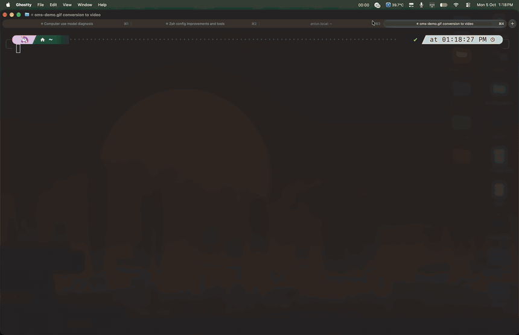

<div align="center">

# oms

Omarchy themes for your whole desktop, on macOS and Linux: Ghostty, your wallpaper and your apps, switched with one key.

[](https://github.com/Mr-Sunglasses/oms/actions/workflows/ci.yml) [](https://github.com/Mr-Sunglasses/oms/releases/latest) [](https://oms.kanishkk.xyz)




<sub>▶ [Watch in full quality](https://oms.kanishkk.xyz/demo.mp4)</sub>

</div>

## Install

```sh
curl -fsSL https://kanishkk.xyz/oms | bash
```

Then run `oms`. Works on Apple silicon and Intel Macs, and on Linux (x86_64 and ARM64). When a new version is out, `oms` asks if you want to update. To stop it checking GitHub for new versions and themes, set `OMS_NO_UPDATE_CHECK=1`.

Tab completion for your shell: add `source <(oms completions zsh)` to `~/.zshrc` (or `bash`, or `oms completions fish | source` for fish).

### On Linux

oms sets the wallpaper with your desktop's own tool, so nothing extra to install on most setups:

| Desktop | Uses |
|---|---|
| Omarchy | `omarchy-theme-bg-set` (Omarchy's own background, videos included) |
| XFCE (Kali's default) | `xfconf-query` |
| GNOME, Ubuntu, Pop, Budgie | `gsettings` |
| KDE Plasma | `plasma-apply-wallpaperimage` |
| Hyprland | `swww` if it's running, else `hyprpaper` |
| Sway | `swww` if it's running, else `swaybg` (via `swaymsg`) |
| Other X11 window managers | `feh` |

It finds Omarchy by its `omarchy-theme-bg-set` command and other desktops from `XDG_CURRENT_DESKTOP`; set `OMS_WALLPAPER_BACKEND` (`omarchy`, `xfce`, `gnome`, `kde`, `hyprland`, `sway` or `feh`) to choose. Light/dark switching, wallpaper rotation and live wallpapers run as a systemd user service. `oms doctor` checks all of this.

On Omarchy, Ghostty's config includes Omarchy's theme colors, which would hide the theme you pick in oms. oms comments that include out (with a note saying how to undo it) the first time it sets a theme.

## What it does

- **Every Omarchy theme** for [Ghostty](https://ghostty.org), with a live preview as you browse.
- **Matching wallpapers**, set on every desktop and screen at once.
- **Light and dark mode:** pick a day theme and a night theme, and oms switches between them when your system does.
- **Your apps too:** Neovim, btop, bat, tmux and the accent color (macOS, or GNOME 47+) can follow the theme.
- **Live wallpapers:** add a video and it plays behind your desktop icons.
- **Wallpaper rotation**, favorites, search, and your own wallpapers.

## Using it

Run `oms` and pick a theme. The main keys:

| Key | Does |
|---|---|
| <kbd>↑</kbd> <kbd>↓</kbd> | Choose a theme |
| <kbd>←</kbd> <kbd>→</kbd> | Choose a wallpaper (or click a thumbnail) |
| <kbd>Enter</kbd> | Apply both |
| <kbd>u</kbd> | Undo |
| <kbd>f</kbd> | Favorite |
| <kbd>/</kbd> | Search |
| <kbd>Tab</kbd> | Show all, dark or light themes |
| <kbd>L</kbd> / <kbd>D</kbd> | Use for light / dark mode |
| <kbd>?</kbd> | All keys |

The mouse works too: click or scroll the list and the thumbnails.

Everything also works from the command line:

```sh
oms apply tokyo-night                 # apply a theme and its wallpaper
oms auto catppuccin-latte tokyo-night # light and dark themes
oms rotate 30m                        # new wallpaper every 30 minutes
oms apps on nvim btop bat tmux        # theme other apps too
oms wallpapers add nord ~/Pictures    # add your own wallpapers
oms status                            # see what's on
oms doctor                            # check your setup if something's off
oms --help                            # everything else
```

## Live wallpapers

Add a video like any other wallpaper, then pick it (it shows `▶ live` in the picker):

```sh
oms wallpapers add tokyo-night ~/Videos/rain.mp4
```

It plays muted and on a loop, and its first frame becomes the ordinary wallpaper underneath (for the lock screen, and wherever the video can't play).

| Where | How it plays |
|---|---|
| macOS | Built in: the oms agent shows it behind the desktop icons on every screen and Space, and pauses it while it's covered. mp4, m4v and mov. |
| Omarchy | Omarchy plays it itself. |
| Hyprland, Sway | With [mpvpaper](https://github.com/GhostNaN/mpvpaper), if it's installed. Also webm and mkv. |
| GNOME, KDE, XFCE, X11 | These can't show a video as the wallpaper, so you get its first frame. |

On Linux, oms takes the first frame with `ffmpeg`. Set a picture again, or change the wallpaper in your system settings, and the video stops.

## My Ghostty config

oms also ships the Ghostty config I use: FiraCode font, a little transparency, a smooth cursor trail and handy keybindings. On Linux you get a Linux version: keybindings on `ctrl+shift` (the super key belongs to your desktop), and no macOS-only settings. Installing it keeps your config's includes and `async-backend` (Omarchy's fix for Hyprland).

```sh
oms config install               # use all of it (your current config is backed up)
oms config install --only font   # or just part of it (see: oms config sections)
oms config restore               # go back to yours
```

## Uninstall

```sh
oms uninstall
```

## Contributing

You need [Rust](https://rustup.rs) and a Mac or a Linux machine.

```sh
git clone https://github.com/Mr-Sunglasses/oms
cd oms
cargo run                 # run the picker
cargo test                # run the tests
```

CI runs these on every pull request, so run them before you push:

```sh
cargo fmt                                    # formatting (rules in rustfmt.toml)
cargo clippy --all-targets -- -D warnings    # lints, including clippy's pedantic set (see [lints] in Cargo.toml)
cargo test
```

Code style:
- Keep each file to one job and under about 400 lines; split a growing one into a folder of modules (like `src/app/` and `src/ui/`).
- Keep functions under 100 lines (clippy enforces this).
- Every `unsafe` block gets a `// SAFETY:` comment saying why it's sound (also enforced).
- Comments explain *why*; names explain *what*.

- **Code:** `src/`. The picker's state and input are in `src/app/`, its drawing in `src/ui/`; theme, wallpaper and app changes are in `ghostty.rs`, `src/wallpaper/` and `src/apps/`. Platform code lives in its own modules: `src/wallpaper/{macos,linux}` and `src/daemon/{launchd,systemd}.rs`. Commands for shell completion are listed once in `completions.rs`, and apps once in `apps::APPS`; a test checks `--help` against both.
- **Themes and wallpapers** come from [ghostty-omarchy-themes](https://github.com/Mr-Sunglasses/ghostty-omarchy-themes) and [omarchy-wallpapers](https://github.com/Mr-Sunglasses/omarchy-wallpapers); change them there.
- **Website:** `site/`. It deploys to [oms.kanishkk.xyz](https://oms.kanishkk.xyz) on every push to `main`. After themes change, run `site/build.py`; it refreshes `themes.json`, the thumbnails and the theme count on the page.
- **Releases:** bump `version` in `Cargo.toml` and push a tag like `v0.6.0`. GitHub Actions builds and publishes it.

<details>
<summary>Signing releases</summary>

Releases are unsigned until these repository secrets exist. Once they do, builds are signed and notarized automatically:
`APPLE_CERTIFICATE` (Developer ID .p12, base64), `APPLE_CERTIFICATE_PASSWORD`, `APPLE_SIGNING_IDENTITY`, `APPLE_ID`, `APPLE_TEAM_ID`, `APPLE_APP_PASSWORD`.

</details>

Issues and pull requests are welcome.

## Credits

Themes and wallpapers come from [Omarchy](https://github.com/omacom/omarchy) and their original authors and artists. [MIT License](LICENSE).


